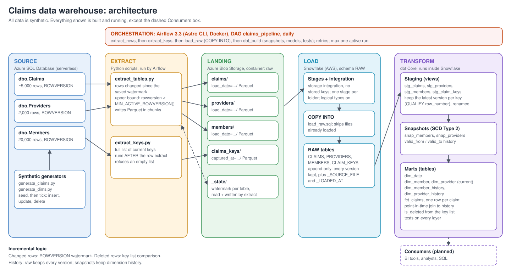

# Claims Data Warehouse

An end-to-end ELT pipeline that moves health-insurance-style claims data from an OLTP database
(Azure SQL) into a Snowflake star schema. Data is extracted incrementally, landed as Parquet in
Azure Blob Storage, loaded with `COPY INTO`, modeled and tested with dbt, and orchestrated by
Airflow.

> **Independent learning project.** All data is synthetic, produced by the generator scripts in
> `source/`. No real or employer data is used.



## Stack

| Layer | Technology |
|---|---|
| Source | Azure SQL Database (serverless), `ROWVERSION` columns |
| Extract | Python: `pyodbc`, `pyarrow` |
| Landing | Azure Blob Storage, Parquet |
| Load | Snowflake: storage integration, external stages, `COPY INTO` |
| Transform | dbt Core 1.12 with `dbt-snowflake` |
| Orchestration | Apache Airflow 3.3 (Astro CLI, Docker) |
| CI | GitHub Actions |

## What the pipeline does

The Airflow DAG `claims_pipeline` runs four tasks, in order, once a day:

1. **extract_rows**: reads new and changed rows from `Claims`, `Providers` and `Members` since
   each table's watermark and writes them to Blob as Parquet.
2. **extract_keys**: writes the full list of current claim IDs, used to detect deletes.
3. **load_raw**: `COPY INTO` the append-only `RAW` tables in Snowflake.
4. **dbt_build**: snapshots, staging models, dimensions and the fact table, with tests at every layer.

## Design decisions

### Incremental extraction with ROWVERSION
- SQL Server changes a row's `ROWVERSION` on every insert and update automatically, so it is a
  more reliable watermark than an application-maintained `LastUpdatedAt` column.
- The extract query has an upper bound of `MIN_ACTIVE_ROWVERSION()`. Without it, a row from a
  transaction that commits late could receive a rowversion below the saved watermark and be
  skipped forever.
- The watermark is saved only after every file for a table has uploaded, and it is stored in
  Blob (`_state/`), not on one machine, so any runner can continue where the last run stopped.

### Landing in Blob before Snowflake
Extraction and loading are separate steps. The Parquet files are an audit trail and allow any
load to be replayed or the raw layer to be rebuilt without touching the source system.

### Append-only raw layer
`RAW` keeps every version of every row the extract has seen, with `_SOURCE_FILE` and
`_LOADED_AT` for lineage. Staging models keep the latest version per key with
`QUALIFY row_number() ... = 1`.

### Detecting deletes
A watermark can never see a deleted row. After each row extract, the pipeline captures the full
list of current claim IDs; a claim missing from the newest list is flagged `is_deleted` rather
than removed, so history is preserved.
- The key list is captured **after** the row extract. Capturing it first would let a claim
  inserted in between be flagged as deleted.
- The extract refuses to write an empty key list, and two dbt tests fail the build if the list
  is empty or older than the newest claim.

### History: SCD Type 2
- dbt snapshots (`timestamp` strategy) record each version of members and providers.
- `dim_member_history` and `dim_provider_history` add surrogate keys and half-open
  `[valid_from, valid_to)` ranges; the earliest version of each entity is valid from 1900.
- `fct_claims` joins to the version valid on the claim's received date (a point-in-time join),
  so a claim shows the plan the member had when it was filed.
- Snapshot tables are permanent (`transient: false`), because their history cannot be rebuilt.
  Rebuildable models stay transient, dbt's default on Snowflake.

### Idempotent, retry-safe orchestration
Every step can be rerun safely, which is what makes automatic retries safe:
- extract: unique file names; the watermark advances only after a successful upload
- load: `COPY INTO` skips files it has already loaded
- dbt: models rebuild from raw; snapshots add a version only when something changed
- `max_active_runs=1` prevents two runs racing on the same watermark

Extract tasks retry because the serverless database can take a minute to resume from auto-pause.

### Data quality
`unique` and `not_null` on every key, `accepted_values` on status codes, `relationships` from
the fact table to every dimension, and singular tests for "exactly one current version per
member", "key list not empty" and "key list not stale".

## Data model

| Model | Grain | Notes |
|---|---|---|
| `fct_claims` | one row per claim | measures: allowed, negotiated, discount, days to pay; `is_paid`, `is_deleted` |
| `dim_member`, `dim_provider` | one row per entity | current state (Type 1) |
| `dim_member_history`, `dim_provider_history` | one row per entity version | Type 2, surrogate keys |
| `dim_date` | one row per day | generated, 2020 onward |

## Repository layout

```
source/      Azure SQL DDL, synthetic data generators, connection test
snowflake/   one-time Snowflake setup SQL, load and rebuild scripts
airflow/     Astro project (Airflow 3.3)
  dags/                    claims_pipeline DAG
  include/scripts/         extract scripts
  include/sql/             load SQL used by the DAG
  include/dbt/claims_dbt/  dbt project
  include/dbt/profiles.yml dbt profile (all values from environment variables)
docs/        architecture diagram
.github/     CI workflow
```

## Running it

Prerequisites: an Azure SQL database, an Azure storage account with a `raw` container, a
Snowflake account, Docker Desktop, the Astro CLI, and Python 3.12+ with ODBC Driver 18.

1. Create the source tables and seed data: `python source/generate_claims.py init`, then `seed`;
   the same for `generate_dims.py`.
2. Run the extracts once, then the Snowflake setup scripts in `snowflake/`, in numbered order.
3. Copy `env_template.txt` values into `airflow/.env` (never committed).
4. `cd airflow`, `astro dev start`, then trigger `claims_pipeline` from `http://localhost:8080`.

To create changes for the pipeline to pick up: `python source/generate_claims.py tick` and
`python source/generate_dims.py tick`.

## Problems I ran into

- **Parquet timestamps loaded as numbers.** Timezone-naive Parquet timestamps were inferred as
  `NUMBER` (raw microseconds). Fixed with `USE_LOGICAL_TYPE = TRUE` on the file format and a
  rebuild of the raw tables. Found by a failing `datediff` in the fact table.
- **Random values that came out NULL.** `CHOOSE(ABS(CHECKSUM(NEWID())) % 4 + 1, ...)` re-evaluates
  `NEWID()` per branch, so it can return NULL. Values are now chosen per row in Python, and
  `not_null` tests were added, because `accepted_values` does not flag NULLs.
- **Serverless wake-up errors (40613).** Handled with retries in the scripts and in Airflow.
- **ODBC driver install on Debian 13.** Microsoft signs the newer repository with a different
  key; installing Microsoft's `packages-microsoft-prod.deb` sets the right key and source.
- **Transient tables by default.** dbt creates transient tables on Snowflake; snapshot tables
  were converted to permanent.

## Known limitations and next steps

- A delete is detected only when the next key list is captured, and the full key list is read
  each run (cheap for millions of rows, heavier for billions).
- A row that changes several times between extracts keeps only its final state; change data
  capture would record every change.
- Snapshots record dimension state as of each run, not every change at the source.
- Password authentication; key-pair authentication with a dedicated service user is the next step.
- Storage (Azure) and warehouse (Snowflake on AWS) are in different clouds, which adds a small
  data-transfer cost; production setups usually co-locate them.
- Synthetic data at small volume; a scale test with tens of millions of rows is planned.
